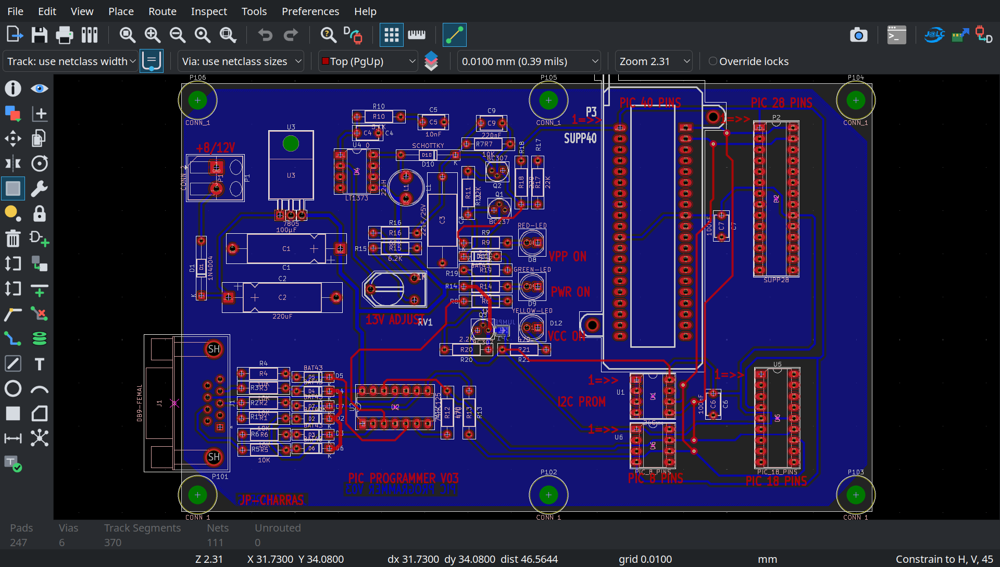
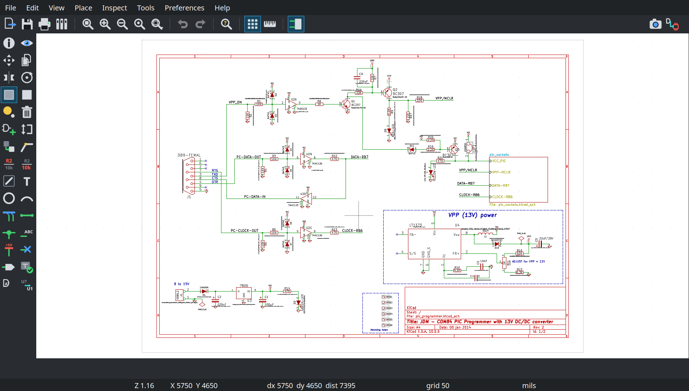
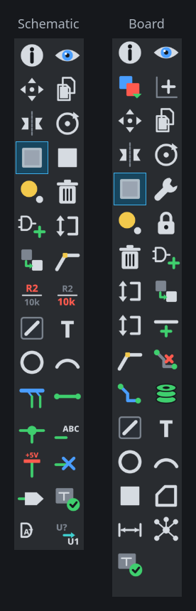
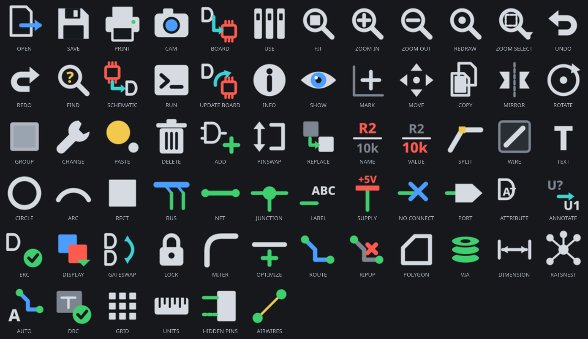

# Talon

**KiCad 10, made to look and work like Eagle 7.**

## Why this exists

I learned Eagle well before version 7 and designed boards in it every day for
ten years. Version 7 was the last one CadSoft made before Autodesk bought the
company in 2016. Version 8, in 2017, was Autodesk's first, and it went
subscription-only and started moving things around. In 2020 Eagle stopped
being sold on its own and became part of Fusion, and on June 7, 2026 Autodesk
stopped selling and supporting it altogether.
The tool I knew by hand was gone. In its place was a subscription, and a
workflow that only held together if you stayed inside Autodesk's walls.

Now that people have been replacing Fusion with SolidCraft, the mechanical
side has a free, open answer. The electronics side is where the gap is. What
Eagle and Fusion did well together was the round trip: draw the board, see it
in the enclosure, fix it, go again. Talon is half of filling that gap. The
other half is the Push to SolidCraft plugin, which sends the board from KiCad
straight into the SolidCraft model. Together they are a real option for
anyone who was forced off Autodesk, or who is tired of paying more every year
for tools that keep getting worse.

KiCad is already the best free board tool there is. Talon doesn't replace it.
It makes KiCad feel like home if your hands learned Eagle, set up the way
Eagle 7 had it, before Autodesk changed it: Eagle's
command column, command-then-click editing, mouse, keys, layer names and
colours, and a dark icon set drawn after Eagle 7's.

Underneath it is still KiCad: the same files, libraries, design rules and
fabrication output. Nothing here changes what a board is, only how you drive
the editor that makes it.



*The board editor, showing KiCad's own `pic_programmer` demo with Eagle's
colours. The command column is on the left. CAM output, the plugin buttons and
the switch to the schematic sit at the far right of the top bar.*



*The schematic editor: the same column, Eagle's white sheet with green nets.*

## What you get

### Eagle's command column



Eagle 7 kept its commands in a two-wide column down the left, in pairs that
belong together: move beside copy, mirror beside rotate, route beside via.
Both editors get that column back, in Eagle 7's own pairs and order, and only
the commands Eagle had. KiCad's other tools are still in the menus.

The top bar is Eagle's action bar: open, save, print, the zoom group,
undo and redo, and find. On the far right are CAM output and the
schematic/board switch, where your eye goes for them.

KiCad's side panels (layers, properties, search) are hidden, so the drawing
runs edge to edge as it did in Eagle. The icons are drawn at 40 pixels.

### Command first, then the part

In KiCad you select something and then say what to do with it. Eagle is the
other way round, and this restores that order. Click **MOVE**, **ROTATE**,
**MIRROR**, **DELETE**, **COPY**, **INFO**, **NAME**, **VALUE**, **LOCK**,
**PINSWAP**, **GATESWAP**, **SPLIT**, **RIPUP** and the rest, then click the
part. The command stays armed for the next part until you press Escape, just
like Eagle.

If something is already selected, the command acts on that straight away. On
the board, clicking a pad takes the whole part, as Eagle did.

### The mouse

| Doing this | Does this |
|---|---|
| Middle-click while routing | Drops a via and carries on routing on the other layer |
| Right-click while moving | Rotates the part |
| Right-click while routing or drawing a wire | Changes the bend |
| Wheel | Zooms around the cursor |
| Middle-drag | Pans |
| Right-drag | Nothing, so a slip does no harm |

### The keys

Eagle's default key table:

| Key | Command | Key | Command |
|---|---|---|---|
| Ctrl+Z, F9 | Undo | Ctrl+Y, F10 | Redo |
| Shift+Ctrl+A | Add | Shift+Ctrl+C | Copy |
| Ctrl+D | Delete | Shift+Ctrl+D | DRC / ERC |
| Ctrl+I | Info | Ctrl+M | Move |
| Shift+Ctrl+N | Name | Shift+Ctrl+V | Value |
| Shift+Ctrl+P | Polygon | Ctrl+T | Text |
| Ctrl+R | Route | Shift+Ctrl+R | Ripup |
| Ctrl+W | Wire | Ctrl+F | Find |
| Alt+F2 | Fit | F2 | Redraw |
| F3 / F4 | Zoom in / out | F5 | Centre on cursor |
| F6 | Grid | Alt+F7 | Measure |

Any KiCad shortcut that clashed with these is moved off. KiCad's
single-letter keys stay wherever nothing else wants them, so M still moves and
X still routes.

### Colours

A black board with red top copper, blue bottom copper, green pads and vias,
and yellow airwires. A white schematic with green nets and dark red symbols.

### Layer names

Top, Bottom, Route2–15, tPlace/bPlace, tStop/bStop, tCream/bCream,
tGlue/bGlue, tKeepout/bKeepout, tDocu/bDocu, Dimension, Document, Measures.

Every new project starts with these names. An existing board can be renamed
with one command (see below). Fabrication files are not affected: they name
layers by their fixed identity, not by what you call them.

### Icons



One icon per command, light lines on dark with Eagle's colour touches where
Eagle had them: red for top copper, blue for bottom, green for nets. Each
keeps the meaning of Eagle 7's picture (move is a four-way arrow, ripup is a
track with a red cross) but the drawing is new. No Autodesk artwork is
included.

## Install

Close KiCad, then:

```
git clone https://github.com/Xeno-va/talon.git
cd talon
./install.sh
```

The script:

1. installs what KiCad needs to compile (asks for your password);
2. downloads KiCad 10.0.6, applies the patch in `patches/` and builds it (the
   first build takes a while);
3. installs the result in `~/.local/opt/kicad-eagle`, beside your normal KiCad,
   which is not touched;
4. points KiCad's menu entries in your home folder at the new build;
5. draws the icons and writes every setting.

Then open KiCad from the menu as usual.

### Settings only

```
./install.sh --settings-only
```

Leaves your KiCad as it is and only writes the settings, icons and colours.
You get the layout, keys, colours and layer names, but not the parts that
need the patch: the two-wide column (you get one column), command-then-click,
and the Eagle mouse.

### Renaming an existing board's layers

Close the board in KiCad first. A copy of the original is kept beside it.

```
python3 setup/eaglelayers.py my-board.kicad_pcb
python3 setup/eaglelayers.py my-board.kicad_pcb --check   # show the names, change nothing
python3 setup/eaglelayers.py my-board.kicad_pcb --undo    # put KiCad's names back
```

### After a KiCad upgrade

Run `./install.sh` again.

### Removing it

Delete `~/.local/share/applications/org.kicad.*.desktop` and
`~/.config/environment.d/kicad-eagle.conf`. The menu entries go back to your
normal KiCad. Delete `~/.local/opt/kicad-eagle` to remove the build. Your
KiCad settings are in `~/.config/kicad/10.0/`; restore a copy if you kept one,
or delete the folder to start fresh.

### Requirements

Written and tested on Fedora 44 with KiCad 10.0.6. Needs `python3`,
ImageMagick and KiCad 10 with its Python module. On another distribution,
install KiCad's build requirements your own way and run
`SKIP_DEPS=1 ./install.sh`.

## Changing it

Everything is written by `setup/apply.py`. The command column, top bar, keys,
mouse, colours and panels are plain tables at the top of that file: edit one
and run it again (with KiCad closed).

`settings/` holds the files it produces, to read or to copy by hand into
`~/.config/kicad/10.0/`:

| File | What it is | Goes in |
|---|---|---|
| `eeschema-toolbars.json`, `pcbnew-toolbars.json` | Top bar and command column | `toolbars/` |
| `user.hotkeys` | Every key that differs from KiCad's | the folder itself |
| `eagle7.json` | The colour scheme | `colors/` |

Copied by hand, KiCad also needs custom toolbars switched on and the colour
scheme chosen in its preferences, and the icons need the icon pack
`apply.py` builds.

The patch in `patches/` is small and touches eight KiCad source files: the
via on middle-click, rotate and bend on right-click, the two-wide column, the
stretch spacer that pushes the switch to the far right, command-then-click,
and pads that can't be picked on their own.

## Testing

`test/` drives both editors for real: it clicks every button on the top bar
and in the column, then checks what each one did and that undo put it back.
It runs KiCad through X11 and moves your mouse, so your desktop will ask
permission first.

## Known gaps

- Eagle's schematic MARK and CHANGE have no working KiCad counterpart in the
  schematic editor, so they are left out of that column.

## Credits and licence

The colour scheme starts from "Eagle Dark" by DX-MON
([pointhi/kicad-color-schemes](https://github.com/pointhi/kicad-color-schemes),
CC0). The patch modifies KiCad, which is GPL-3.0, and this repository is
GPL-3.0 too.

Not affiliated with Autodesk or the KiCad project. EAGLE is a trademark of
Autodesk.
